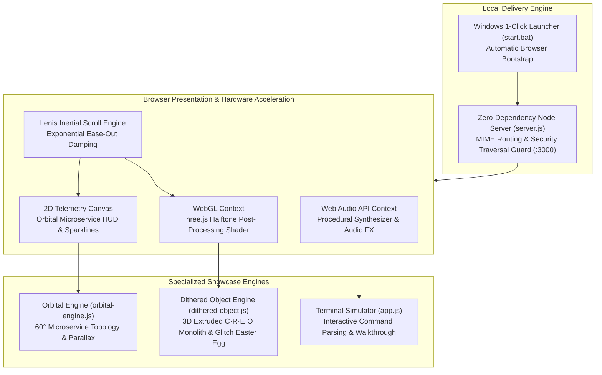

<div align="center">

# Creo — Interactive 3D Showcase & Developer Experience Platform

**High-Performance WebGL & Cybernetic Showcase for the Creo Windows Terminal Orchestrator**

<p align="center">
  <a href="https://github.com/tanmayythakare/creo"></a>
  <a href="https://threejs.org/"></a>
  <a href="https://greensock.com/gsap/"></a>
  <a href="https://github.com/darkroomengineering/lenis"></a>
  <a href="https://developer.mozilla.org/en-US/docs/Web/API/Web_Audio_API"></a>
  <a href="LICENSE"></a>
  <a href="#quickstart"></a>
</p>

<p align="center">
  Cybernetic microservice orchestration matrix, extruded Three.js halftone post-processing, and interactive terminal simulator.<br>
  Zero external runtime dependencies · 60/120fps GPU-accelerated rendering · Procedural Web Audio API soundscape.
</p>

<p align="center">
  <a href="#quick-flow">Quick Flow</a> •
  <a href="#system-architecture">Architecture</a> •
  <a href="#core-architectural-modules">Core Modules</a> •
  <a href="#quickstart">Quickstart</a> •
  <a href="#keyboard-shortcuts--easter-eggs">Keyboard Shortcuts</a> •
  <a href="#repository-structure">Repository Structure</a>
</p>

</div>

---

> [!NOTE]
> **Showcase Platform for the Creo CLI Ecosystem**
> This repository is the interactive visual showcase for **[creo](https://github.com/tanmayythakare/creo)**, the developer workspace orchestrator for Windows Terminal (`wt.exe`).
> For the custom Windows package manager distribution, see **[scoop-bucket](https://github.com/tanmayythakare/scoop-bucket)**.

---

## Quick Flow

```
npm start  →  WebGL Shader Pipeline  →  Orbital Microservice HUD  →  Interactive Terminal Simulator
```

---

## System Architecture



---

## Core Architectural Modules

### 01. Cybernetic Radial Microservice Orchestration Matrix
* **Hexagonal Radial Topology**: Calibrated 60° angular distribution of 6 essential microservice cards (`Frontend SPA :4200`, `Backend API :8080`, `Redis Cache :6379`, `Worker / Jobs Async DAG`, `PostgreSQL :5432`, `File Storage S3 Assets`).
* **Interactive 3D Mouse Parallax**: Multi-plane depth calculations driven by mouse velocity with dynamic vector conduit packet pulses.
* **Telemetry Sparkline Waveforms**: Procedurally rendered real-time activity graphs reflecting continuous health states.

### 02. Extruded 3D Halftone Dither Monolith & Viewport Culling
* **Custom Three.js WebGL Shader**: Custom halftone dither post-processing pass transforming extruded geometric brand typography into retro-futuristic digital artifacts.
* **Automated Viewport Culling**: IntersectionObserver pauses the WebGL rendering loop when scrolled off-screen, reserving 100% GPU fill rate for surrounding interface layers.
* **Terminal Dissolve Easter Egg**: Typing `creo` anywhere on the physical keyboard triggers a terminal glitch matrix transformation from neon purple to the pure white ASCII edition.

### 03. Interactive Windows Terminal Emulator & AST Parser
* **Full CLI Command Execution**: Browser-based Windows Terminal simulation handling live commands (`creo init`, `creo up`, `creo status`, `creo stop`, `creo drop`).
* **Visual State Transitions**: Triggers chromatic disintegration reverse-dissolve animations on teardown (`creo drop`).
* **Non-Blocking Guided Tour**: Conflict-free, interruptible automated demo walkthrough showcasing orchestrator ergonomics.

### 04. Smooth Inertial Scroll & Procedural Audio Synthesizer
* **Exponential Ease-Out Damping**: Local Lenis implementation eliminates notched mouse wheel stutter on Windows, delivering continuous 60/120fps refresh rate parity.
* **Pure Web Audio Procedural Synthesis**: Synthesizes mechanical keypress clicks, sub-bass laser surges, and sweep frequencies without external audio sample files.
* **Paint Containment**: Leverages CSS `content-visibility: auto` to bypass rendering off-screen DOM nodes until user approach.

---

## Tech Stack

| Layer | Technology | Version / Spec | Purpose |
| :--- | :--- | :--- | :--- |
| **3D Rendering** | Three.js | r128+ | WebGL scene graph, geometry extrusion, and halftone shader pipeline |
| **Animation** | GSAP | 3.12.x | High-performance timeline sequencing and layout morphing |
| **Scroll Engine** | Lenis | 1.0.x | Inertial scroll damping and momentum physics |
| **Sound Synthesis** | Web Audio API | W3C Standard | Procedural mechanical audio synthesis and 4-bar equalizer |
| **Local Runtime** | Node.js | v18+ | Zero-dependency static server with directory traversal defense |
| **Styling** | Modern CSS | CSS3 / Custom Props | Glassmorphism, CSS grid, and cybernetic HUD aesthetic |

---

## Quickstart

### Prerequisites
* **Node.js 18+** (or modern web browser for direct file execution)

---

### Option 1: 1-Click Windows Launcher
Double-click `start.bat` in the repository root. It launches the local server and automatically opens **`http://localhost:3000`** in your default browser.

---

### Option 2: Node.js Command Line
```bash
# Clone the repository
git clone https://github.com/tanmayythakare/creo-intro.git
cd creo-intro

# Launch zero-dependency local server
npm start
```

Open **[http://localhost:3000](http://localhost:3000)** in your browser.

---

## Keyboard Shortcuts & Easter Eggs

| Action | Shortcut / Trigger | Description |
| :--- | :--- | :--- |
| **Command Palette** | `Ctrl + K` or `Cmd + K` | Opens global quick navigation and telemetry actions |
| **White Edition Logo Easter Egg** | Type `c` `r` `e` `o` | Triggers cybernetic glitch transition to pure white monochrome edition |
| **Dismiss Modals** | `Esc` | Closes active command palettes and preview dialogs |
| **Terminal Scenario Cycling** | Direct Click / Typing | Executes scenarios directly inside the terminal simulator |

---

## Repository Structure

```
creo-intro/
├── assets/                     # Brand marks & 3D isometric typography glyphs
│   ├── brand-glyph-solid.svg   # 3D isometric 'C' glyph (Neon Violet)
│   ├── brand-glyph-solid-white.svg
│   ├── creo-r.svg              # 3D isometric 'R' glyph
│   ├── creo-e.svg              # 3D isometric 'E' glyph
│   ├── creo-o.svg              # 3D isometric 'O' glyph
│   └── favicon.svg             # Application favicon
├── css/
│   └── index.css               # Design system tokens & HUD styling
├── js/
│   ├── app.js                  # Central application controller & interactive demos
│   ├── orbital-engine.js       # Section 01 Cybernetic radial matrix engine
│   ├── dithered-object.js      # Section 02 Three.js Halftone shader engine
│   └── scene3d.js              # 3D spatial cyberspace utilities
├── lib/                        # Local vendor libraries (100% offline & zero-CORS)
│   ├── lenis.min.js            # Smooth inertial scroll engine
│   ├── three.module.js         # Three.js 3D rendering core
│   ├── OrbitControls.js        # Three.js orbit controls
│   └── gsap.min.js             # GSAP animation library
├── previews/                   # Standalone sandbox prototypes
│   ├── logo-preview.html       # Isolated 3D logo testbed
│   ├── orbital-preview.html    # Isolated orbital HUD testbed
│   └── decrypt-reveal.js       # Text decryption animation prototype
├── index.html                  # Single-page showcase application
├── error.html                  # 404 fallback document
├── server.js                   # Zero-dependency Node.js HTTP server
├── start.bat                   # 1-click Windows desktop launcher
└── package.json                # Project metadata & start script
```

---

## Contributing

1. Fork the repository.
2. Clone your fork:
   ```bash
   git clone https://github.com/tanmayythakare/creo-intro.git
   ```
3. Create your feature branch:
   ```bash
   git checkout -b feat/your-feature-name
   ```
4. Commit your changes:
   ```bash
   git commit -m "feat: add descriptive feature summary"
   ```
5. Push to your branch and submit a Pull Request.

---

## License

This project is open-source and distributed under the **[MIT License](LICENSE)**.

---

## Author

**Tanmay Thakare**
* GitHub: [@tanmayythakare](https://github.com/tanmayythakare)
* Email: [tanmayrthakare@gmail.com](mailto:tanmayrthakare@gmail.com)
* LinkedIn: [Tanmay Thakare](https://www.linkedin.com/in/tanmaythakare)

---

<div align="center">
  <a href="https://github.com/tanmayythakare">
    
  </a>
</div>
